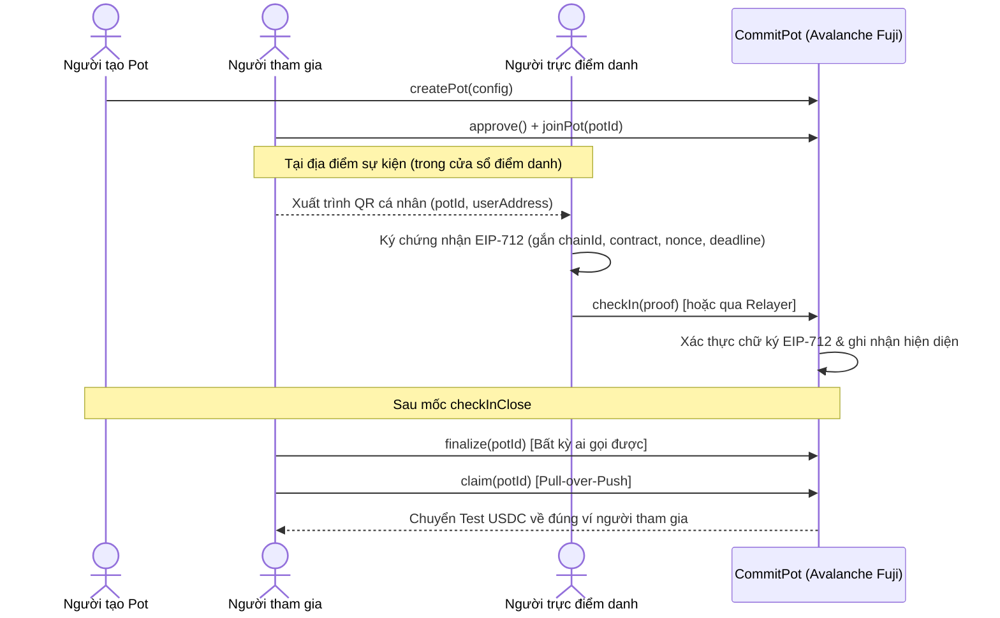

# CommitPot — Quỹ Cam Kết Hiện Diện Trên Avalanche

> **Có mặt đúng hẹn, nhận lại tiền cam kết.**  
> Quỹ cam kết với luật tài chính bất biến trên chuỗi, xác nhận hiện diện có trách nhiệm, và quyết toán kiểm chứng được.

Dự án tham dự **Avalanche Team1 Vietnam UniHack 2026** (Triển khai trên Avalanche Fuji Testnet).

---

## 1. Bài toán & Phạm vi MVP

Các buổi học nhóm, workshop kỹ thuật hoặc meetup cộng đồng thường xuyên gặp tình trạng đăng ký ảo (no-show). Các giải pháp thu cọc truyền thống (chuyển khoản thủ công + Google Form) buộc thành viên phải tin tuyệt đối vào người giữ quỹ và dễ gây tranh cãi khi chia lại tiền.

**CommitPot** giải quyết bài toán này trong một phạm vi hẹp, định lượng được:
- Một nhóm chốt trước mức cọc (`stakeAmount`), loại token (Test USDC), và 3 mốc thời gian trước khi mở đăng ký.
- Người tham gia nạp cọc vào Smart Contract.
- Tại địa điểm sự kiện, người trực điểm danh (`Verifier`) xác nhận hiện diện bằng chứng nhận chữ ký **EIP-712** gắn riêng cho từng ví.
- Hết giờ điểm danh, bất kỳ ai cũng có thể kích hoạt quyết toán (`finalize`). Người có mặt tự rút lại tiền cọc kèm phần phân bổ từ cọc của người vắng mặt (`claim`).

### Những gì MVP này KHÔNG làm (Intentional Trade-offs)
- Không nghiệm thu chất lượng học tập hay thời lượng ở lại buổi học (chỉ chứng minh sự kiện điểm danh).
- Không dùng mật khẩu/QR tĩnh dùng chung (tránh rò rỉ trên mempool hoặc chụp ảnh gửi từ xa).
- Không có quyền admin rút quỹ, không phát hành token riêng, không yield/APY, không dùng AI phân xử.
- Chưa triển khai tiền thật (chỉ chạy Test USDC trên Avalanche Fuji Testnet).

---

## 2. Mô hình tin cậy (Trust Model)

CommitPot **không** tuyên bố "hoàn toàn không cần tin ai". Thay vào đó, hệ thống tách bạch rõ ràng quyền kiểm soát tiền và quyền xác nhận hiện diện:

| Chủ thể | Có quyền | Không có quyền |
| :--- | :--- | :--- |
| **Người tạo Pot** | Thiết lập thông số trước khi mở đăng ký | Sửa luật, đổi ví Verifier hoặc rút quỹ sau khi mở |
| **Người trực điểm danh (Verifier)** | Ký chứng nhận EIP-712 xác nhận một ví có mặt | Tự đổi mức thưởng, rút quỹ hoặc chuyển tiền tùy ý |
| **Smart Contract** | Khóa quỹ, kiểm tra chữ ký, tính toán và trả thưởng | Tự biết một người có mặt ngoài đời thực hay không |
| **Người tham gia** | Nạp cọc, xuất trình QR cá nhân, tự rút phần được hưởng | Tự chứng nhận có mặt hoặc dùng lại chứng nhận của ví khác |

---

## 3. Kiến trúc hệ thống (SOLID Monorepo)

Dự án sử dụng kiến trúc **Monorepo** (`pnpm workspaces`) tuân thủ nguyên lý **SOLID** để tách biệt hoàn toàn logic nghiệp vụ, cơ chế xác thực và hạ tầng blockchain:

```text
commitpot-monorepo/
├── packages/
│   └── contracts/                    # Solidity + Foundry (Avalanche Fuji)
│       ├── src/
│       │   ├── core/CommitPot.sol    # Quản lý state quỹ & dòng tiền ERC-20
│       │   ├── interfaces/           # ISP & DIP: IPotAdmin, IPotParticipant, IAttendanceVerifier, IPayoutStrategy
│       │   ├── verifiers/            # EIP712AttendanceVerifier.sol
│       │   ├── strategies/           # EqualSplitStrategy.sol
│       │   └── types/PotTypes.sol    # Structs, Enums, Custom Errors
│       ├── test/                     # Unit & Fuzz tests (Foundry)
│       └── script/DeployFuji.s.sol   # Script deploy & wire dependencies
├── apps/
│   └── web/                          # Next.js (TypeScript) + Tailwind + wagmi/viem
│       └── src/
│           ├── domain/               # Models, Pure Rules, Ports (IPotRepository)
│           ├── infrastructure/       # AvalanchePotRepository (On-chain) & MockPotRepository (Dev)
│           ├── application/          # React Custom Hooks
│           ├── presentation/         # UI Components (QR Card, Scanner, Payout Board)
│           └── app/                  # App Router & Dependency Injection (providers.tsx)
└── docs/
    └── TECHNICAL_SPEC.md             # Đặc tả kỹ thuật chi tiết
```

### Luồng vận hành tổng quan



---

## 4. Hướng dẫn chạy Local (Quick Start)

### Yêu cầu môi trường
- Node.js >= 20, `pnpm` >= 9
- Foundry (`forge`, `cast`)

### Cài đặt & Chạy test Smart Contract
```bash
pnpm install
cd packages/contracts
forge test -vvv
```

### Chạy Frontend (Chế độ Mock — Không cần ví/RPC)
Dùng để phát triển UI song song trước khi nối contract thật:
```bash
cd apps/web
cp .env.example .env.local
# Đặt NEXT_PUBLIC_USE_MOCK=true trong .env.local
pnpm dev
```

### Chạy Frontend (Kết nối Avalanche Fuji Testnet)
Đặt `NEXT_PUBLIC_USE_MOCK=false`, điền `NEXT_PUBLIC_COMMITPOT_ADDRESS` và `NEXT_PUBLIC_USDC_ADDRESS` vào `.env.local`, sau đó chạy `pnpm dev`.

---

## 5. Kịch bản Demo 3 phút (Fuji Testnet)

1. Khởi tạo sẵn một Pot trên Fuji: **5 suất × 10 test USDC** (tổng quỹ 50 USDC), cửa sổ điểm danh rút ngắn cho demo.
2. Quét QR và thực hiện điểm danh EIP-712 cho **4 người tham gia**; cố tình để **1 suất vắng mặt**.
3. Dashboard cập nhật trực tiếp số người đã check-in và mức nhận dự kiến tăng từ 10 lên **12.5 test USDC**.
4. Hết cửa sổ điểm danh, gọi `finalize(potId)` để khóa kết quả.
5. Gọi `claim(potId)` — mỗi ví có mặt nhận chính xác **12.5 test USDC**.
6. Mở Snowtrace (Fuji Explorer) đối chiếu hash giao dịch và log sự kiện.